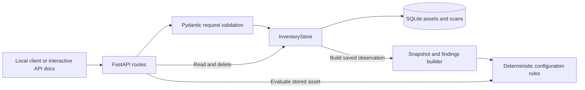

# AI-SPM-Lab

AI Security Posture Management for AI applications, model endpoints, and agents.

AI-SPM-Lab is being developed to inventory AI assets, evaluate configuration
risks, and report actionable security findings with supporting evidence.

## Project status

The API supports validated inventory records for models, endpoints, and agents,
with create, list, read, replace, and delete operations backed by SQLite.
Records survive application restarts. Deterministic configuration checks return
pass, fail, or unknown results from stored declarations. Scans save an asset
snapshot, all check results, and actionable findings in persistent history.
Reports remain planned; checks and scans do not probe live endpoints.

## Quick start

Requires Python 3.10 or newer. From the repository directory on macOS or Linux:

```bash
python3 -m venv .venv
source .venv/bin/activate
python -m pip install -r requirements.txt
python -m uvicorn app.main:app --reload --host 127.0.0.1 --port 8000
```

On Windows PowerShell, create the environment with `py -m venv .venv`, then
activate it with `.venv\Scripts\Activate.ps1`. The remaining commands are the same.

## API

| Method | Path | Purpose |
| --- | --- | --- |
| GET | `/health` | Application health |
| GET | `/docs` | Interactive API documentation |
| GET | `/openapi.json` | OpenAPI specification |
| POST | `/assets` | Create an asset; returns `201` and a `Location` header |
| GET | `/assets` | List assets; `limit` defaults to 50 (1–100), `offset` defaults to 0 |
| GET | `/assets/{asset_id}` | Read an asset by UUID |
| GET | `/assets/{asset_id}/checks` | Evaluate current declared configuration; results are not saved |
| PUT | `/assets/{asset_id}` | Replace metadata, preserving UUID and creation time |
| DELETE | `/assets/{asset_id}` | Delete an asset; returns an empty `204` response |
| POST | `/assets/{asset_id}/scans` | Save a new configuration scan; returns `201` and a `Location` header |
| GET | `/scans` | List scan summaries newest first; optional `asset_id`, `limit`, and `offset` |
| GET | `/scans/{scan_id}` | Read the saved asset snapshot, evaluation, and findings |
| GET | `/scans/{scan_id}/findings` | Read failed-check findings for a saved scan |

```bash
curl -i http://127.0.0.1:8000/health
```

Expected response: HTTP `200 OK` with:

```json
{"status":"ok"}
```

Open <http://127.0.0.1:8000/docs> to explore the API. Stop the server with `Ctrl+C`.
The health endpoint confirms application availability; it does not evaluate
security posture. The current application needs no external API credentials.

## Inventory API

Create an asset using the synthetic example, then list the inventory:

```bash
curl -i -X POST http://127.0.0.1:8000/assets \
  -H 'Content-Type: application/json' \
  --data-binary @examples/asset.json

curl 'http://127.0.0.1:8000/assets?limit=20&offset=0'
```

Use the returned `id` in place of `<asset-id>` below. Edit the example metadata
before the `PUT` request to replace an existing record:

```bash
curl 'http://127.0.0.1:8000/assets/<asset-id>'

curl -X PUT 'http://127.0.0.1:8000/assets/<asset-id>' \
  -H 'Content-Type: application/json' \
  --data-binary @examples/asset.json

curl -i -X DELETE 'http://127.0.0.1:8000/assets/<asset-id>'
```

`PUT` replaces all editable metadata: omitted optional fields return to their
defaults, including unknown security controls when `security` is omitted.
It does not create a missing asset. Lists are ordered by creation time
and then UUID. Missing records return `404`; invalid bodies, UUIDs, or pagination
return `422`. Validation responses describe the error without echoing rejected
input values. Database operational errors return `503` without database paths.

### Storage

The database is created at `data/inventory.sqlite3` on startup, relative to the
working directory. Set `AI_SPM_DB_PATH` to use a different file; parent directories
are created automatically. For example, on macOS or Linux:

```bash
AI_SPM_DB_PATH=/tmp/ai-spm-demo.sqlite3 \
  python -m uvicorn app.main:app --host 127.0.0.1 --port 8000
```

Use the same database path after a restart to retain the inventory. Local data
and SQLite transaction files are excluded from Git. The API is currently an
unauthenticated local development service; keep it bound to `127.0.0.1`.

## Inventory record validation

`AssetCreate` validates user-supplied metadata. `Asset` adds a UUID and a UTC
creation time. The synthetic record in [`examples/asset.json`](examples/asset.json)
can be validated locally without contacting an endpoint:

```bash
python -c 'from pathlib import Path; from app.models import AssetCreate; print(AssetCreate.model_validate_json(Path("examples/asset.json").read_text()).model_dump_json(indent=2))'
```

- Required: `name`, `asset_type` (`model`, `endpoint`, or `agent`), and `owner`.
- `environment`: `development` (default), `staging`, or `production`.
- Optional: `endpoint_url`, `provider`, `model_name`, and up to ten tags.
- Endpoint assets require an HTTP(S) URL. Credentials, query strings, and
  fragments are rejected; store a base URL and never include secrets in metadata.
- Names, owners, providers, and model names are limited to 120 characters;
  tags to 40 characters. Surrounding whitespace is trimmed and duplicate tags
  are removed in their original order. Unknown fields are rejected.

These records describe assets. Saving them does not contact an endpoint or
verify its security.

## Configuration checks

An asset can include a `security` object with owner-declared controls:

```json
{
  "authentication_enabled": true,
  "internet_exposed": false,
  "permissions": ["read"]
}
```

The flags accept JSON booleans or `null`; strings such as `"false"` and numbers
such as `0` are rejected. Permissions accept `read`, `write`, `execute`, `admin`,
or `*`, with at most 20 entries; duplicates are removed. `null` means unknown,
while `[]` explicitly declares no permission grants. An omitted `security`
object defaults to unknown controls, including when reading older saved records.
These controls describe the inventoried asset, not authentication of this API.

Create the [configured synthetic example](examples/asset-configured.json), then
use its returned `id` in the check request:

```bash
curl -X POST http://127.0.0.1:8000/assets \
  -H 'Content-Type: application/json' \
  --data-binary @examples/asset-configured.json

curl 'http://127.0.0.1:8000/assets/<asset-id>/checks'
```

Policy version `1` uses a conservative internal-access baseline:

| Rule | Pass | Fail | Unknown |
| --- | --- | --- | --- |
| `AUTH-001` | Authentication declared enabled | Declared disabled (high) | Not declared |
| `EXPOSURE-001` | Internet exposure declared false | Declared true (medium) | Not declared |
| `TRANSPORT-001` | HTTPS URL configured | HTTP URL configured (medium) | No URL |
| `PERMISSIONS-001` | No `admin` or `*` grants declared | Either grant present (high) | Permissions not declared |

Every result includes its rule ID, status, message, and evidence. Failed checks
also include severity and remediation. The response identifies its basis as
`declared_configuration` and counts `passed`, `failed`, and `unknown` separately.
The configured example yields four passes; the original example yields one
transport pass and three unknowns. No overall security score is calculated.

A pass only satisfies the documented configuration rule. HTTPS does not prove
deployed TLS validity, and a URL does not establish authentication or network
exposure. Public access may be intentional; an exposure failure calls for review
against this internal-access baseline. Permission checks detect declared admin
or wildcard grants; they do not prove least privilege. Results are computed on
request. Use the scan endpoints below to save an observation; neither mode
provides compliance certification or live security tests.

## Saved scans and findings

Create the [exposed synthetic example](examples/asset-exposed.json) to produce
four failed configuration checks. Replace `<asset-id>` and `<scan-id>` with the
UUIDs returned by the corresponding create requests:

```bash
curl -X POST http://127.0.0.1:8000/assets \
  -H 'Content-Type: application/json' \
  --data-binary @examples/asset-exposed.json

curl -i -X POST 'http://127.0.0.1:8000/assets/<asset-id>/scans'

curl 'http://127.0.0.1:8000/scans?asset_id=<asset-id>&limit=20&offset=0'
curl 'http://127.0.0.1:8000/scans/<scan-id>'
curl 'http://127.0.0.1:8000/scans/<scan-id>/findings'
```

No body is required to create a scan; `{}` is also accepted. The server reads the
stored asset and generates scan data itself. Supplied IDs, findings, or evaluation
results are rejected. Every successful `POST` creates a separate observation.

| Saved field | Meaning |
| --- | --- |
| `id`, `asset_id`, `created_at` | Scan UUID, original asset UUID, and UTC observation time |
| `asset_snapshot` | Asset metadata and declared controls when the scan was created |
| `evaluation` | Policy version, declaration-based evidence, all checks, and separate pass/fail/unknown counts |
| `findings` | Failed checks only, with finding UUIDs, rule IDs, severity, evidence, and remediation |

Passing and unknown checks remain in `evaluation`; they do not create findings.
An empty findings list can therefore coexist with unknown controls. Finding IDs
remain stable when rereading a scan; a new scan has new observation IDs, even
when it sees the same failed rule.

`GET /scans` returns summaries ordered by creation time and then UUID, both
descending. Pagination uses the same defaults and limits as the asset list.
Filtering by an unknown asset UUID returns an empty list. Full snapshots and
findings are available through the scan detail endpoints.

Saved results survive restarts and are read-only through the API. Editing or
deleting an inventory asset does not change earlier scans or their findings.
History remains accessible using the scan UUID or original asset filter after
asset deletion. Reading history does not rerun rules; create another scan to
observe updated declarations. Saved scans use the same declaration-based limits
as current checks and do not track remediation status across observations.

## Architecture

The running application has three main layers: API routes, validation, and
file-backed inventory storage.



See the [architecture and request-flow notes](docs/architecture.md) for storage
boundaries, replacement logic, configuration evaluation, and error handling.
The diagrams describe implemented behavior; reports and a dashboard remain planned.

## Validation

Install the development requirements, then run the suite:

```bash
python -m pip install -r requirements-dev.txt
python -m unittest discover -s tests -v
```

Tests cover metadata validation, CRUD responses, pagination, missing records,
rejected-input redaction, SQL-looking text, isolated databases, and persistence
of creates, replacements, and deletions across application restarts.
Configuration tests cover strict flags, null versus empty permissions, legacy
records, deterministic results, evidence, and independent unknown counts.
Scan tests cover saved finding IDs, historical snapshots, restarts, legacy
databases, pagination, failure rollback, and concurrent-write exclusion during
snapshot creation.

## Roadmap

- Controlled evaluation cases for prompt injection and data leakage.
- Reporting with references to relevant OWASP and NIST guidance.
- A local dashboard for inventory, scans, and findings.

## Repository structure

```text
app/
  __init__.py       Application package
  main.py           Application factory and inventory API routes
  models.py         Validated inventory records
  inventory.py      SQLite inventory repository
  checks.py         Declared-configuration rules and result schemas
  scans.py          Scan snapshots, summaries, and failed-check findings
examples/asset.json Synthetic inventory metadata; no real credentials
examples/asset-configured.json Synthetic asset with declared controls
examples/asset-exposed.json Synthetic declarations that fail the configuration baseline
docs/architecture.md Architecture and request-flow diagrams
tests/              Schema, API, and persistence checks
requirements.txt   Application dependencies
requirements-dev.txt Test dependencies
.gitignore         Local environments and secrets excluded from Git
README.md          Project overview and usage
```
