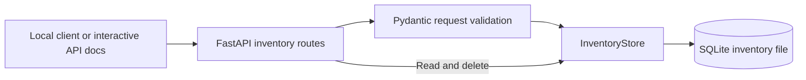

# AI-SPM-Lab

AI Security Posture Management for AI applications, model endpoints, and agents.

AI-SPM-Lab is being developed to inventory AI assets, evaluate configuration
risks, and report actionable security findings with supporting evidence.

## Project status

The API supports validated inventory records for models, endpoints, and agents,
with create, list, read, replace, and delete operations backed by SQLite.
Records survive application restarts. Configuration scanning and findings reports
are planned; no security scan runs yet.

## Quick start

Requires Python 3.10 or newer. From the repository directory on macOS or Linux:

```bash
python3 -m venv .venv
source .venv/bin/activate
python -m pip install -r requirements.txt
python -m uvicorn app.main:app --reload --host 127.0.0.1 --port 8000
```

On Windows PowerShell, create the environment with `py -m venv .venv`, then
activate it with `.venv\Scripts\Activate.ps1`. The remaining commands are the same.

## API

| Method | Path | Purpose |
| --- | --- | --- |
| GET | `/health` | Application health |
| GET | `/docs` | Interactive API documentation |
| GET | `/openapi.json` | OpenAPI specification |
| POST | `/assets` | Create an asset; returns `201` and a `Location` header |
| GET | `/assets` | List assets; `limit` defaults to 50 (1–100), `offset` defaults to 0 |
| GET | `/assets/{asset_id}` | Read an asset by UUID |
| PUT | `/assets/{asset_id}` | Replace metadata, preserving UUID and creation time |
| DELETE | `/assets/{asset_id}` | Delete an asset; returns an empty `204` response |

```bash
curl -i http://127.0.0.1:8000/health
```

Expected response: HTTP `200 OK` with:

```json
{"status":"ok"}
```

Open <http://127.0.0.1:8000/docs> to explore the API. Stop the server with `Ctrl+C`.
The health endpoint confirms application availability; it does not evaluate
security posture. The current application needs no external API credentials.

## Inventory API

Create an asset using the synthetic example, then list the inventory:

```bash
curl -i -X POST http://127.0.0.1:8000/assets \
  -H 'Content-Type: application/json' \
  --data-binary @examples/asset.json

curl 'http://127.0.0.1:8000/assets?limit=20&offset=0'
```

Use the returned `id` in place of `<asset-id>` below. Edit the example metadata
before the `PUT` request to replace an existing record:

```bash
curl 'http://127.0.0.1:8000/assets/<asset-id>'

curl -X PUT 'http://127.0.0.1:8000/assets/<asset-id>' \
  -H 'Content-Type: application/json' \
  --data-binary @examples/asset.json

curl -i -X DELETE 'http://127.0.0.1:8000/assets/<asset-id>'
```

`PUT` replaces all editable metadata: omitted optional fields return to their
defaults. It does not create a missing asset. Lists are ordered by creation time
and then UUID. Missing records return `404`; invalid bodies, UUIDs, or pagination
return `422`. Validation responses describe the error without echoing rejected
input values. Database operational errors return `503` without database paths.

### Storage

The database is created at `data/inventory.sqlite3` on startup, relative to the
working directory. Set `AI_SPM_DB_PATH` to use a different file; parent directories
are created automatically. For example, on macOS or Linux:

```bash
AI_SPM_DB_PATH=/tmp/ai-spm-demo.sqlite3 \
  python -m uvicorn app.main:app --host 127.0.0.1 --port 8000
```

Use the same database path after a restart to retain the inventory. Local data
and SQLite transaction files are excluded from Git. The API is currently an
unauthenticated local development service; keep it bound to `127.0.0.1`.

## Inventory record validation

`AssetCreate` validates user-supplied metadata. `Asset` adds a UUID and a UTC
creation time. The synthetic record in [`examples/asset.json`](examples/asset.json)
can be validated locally without contacting an endpoint:

```bash
python -c 'from pathlib import Path; from app.models import AssetCreate; print(AssetCreate.model_validate_json(Path("examples/asset.json").read_text()).model_dump_json(indent=2))'
```

- Required: `name`, `asset_type` (`model`, `endpoint`, or `agent`), and `owner`.
- `environment`: `development` (default), `staging`, or `production`.
- Optional: `endpoint_url`, `provider`, `model_name`, and up to ten tags.
- Endpoint assets require an HTTP(S) URL. Credentials, query strings, and
  fragments are rejected; store a base URL and never include secrets in metadata.
- Names, owners, providers, and model names are limited to 120 characters;
  tags to 40 characters. Surrounding whitespace is trimmed and duplicate tags
  are removed in their original order. Unknown fields are rejected.

These records describe assets. Saving them does not contact an endpoint or
verify its security.

## Architecture

The running application has three main layers: API routes, validation, and
file-backed inventory storage.



See the [architecture and request-flow notes](docs/architecture.md) for storage
boundaries, replacement logic, and error handling. The diagrams describe the
implemented inventory; scanning, findings, and reports remain planned.

## Validation

Install the development requirements, then run the suite:

```bash
python -m pip install -r requirements-dev.txt
python -m unittest discover -s tests -v
```

Tests cover metadata validation, CRUD responses, pagination, missing records,
rejected-input redaction, SQL-looking text, isolated databases, and persistence
of creates, replacements, and deletions across application restarts.

## Roadmap

- Configuration checks for authentication, exposure, and permissions.
- Findings with severity, evidence, and remediation guidance.
- Controlled evaluation cases for prompt injection and data leakage.
- Reporting with references to relevant OWASP and NIST guidance.

## Repository structure

```text
app/
  __init__.py       Application package
  main.py           Application factory and inventory API routes
  models.py         Validated inventory records
  inventory.py      SQLite inventory repository
examples/asset.json Synthetic inventory metadata; no real credentials
docs/architecture.md Architecture and request-flow diagrams
tests/              Schema, API, and persistence checks
requirements.txt   Application dependencies
requirements-dev.txt Test dependencies
.gitignore         Local environments and secrets excluded from Git
README.md          Project overview and usage
```
