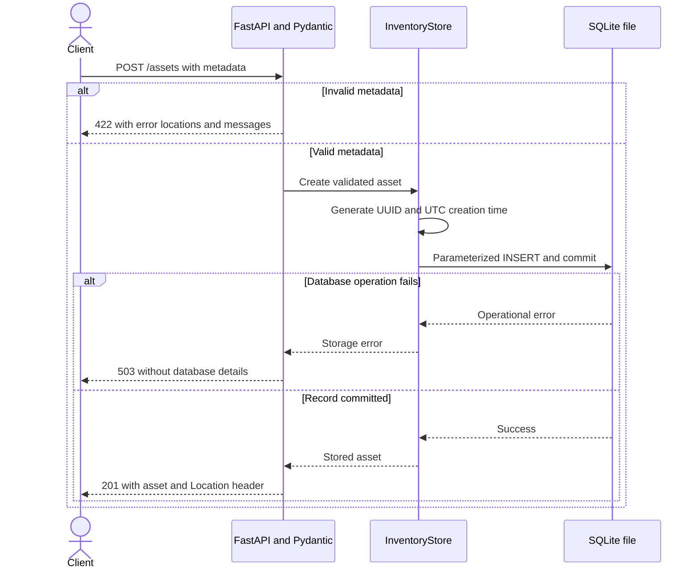
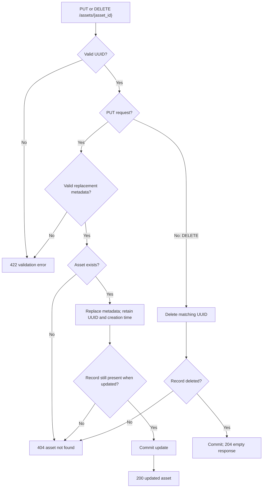
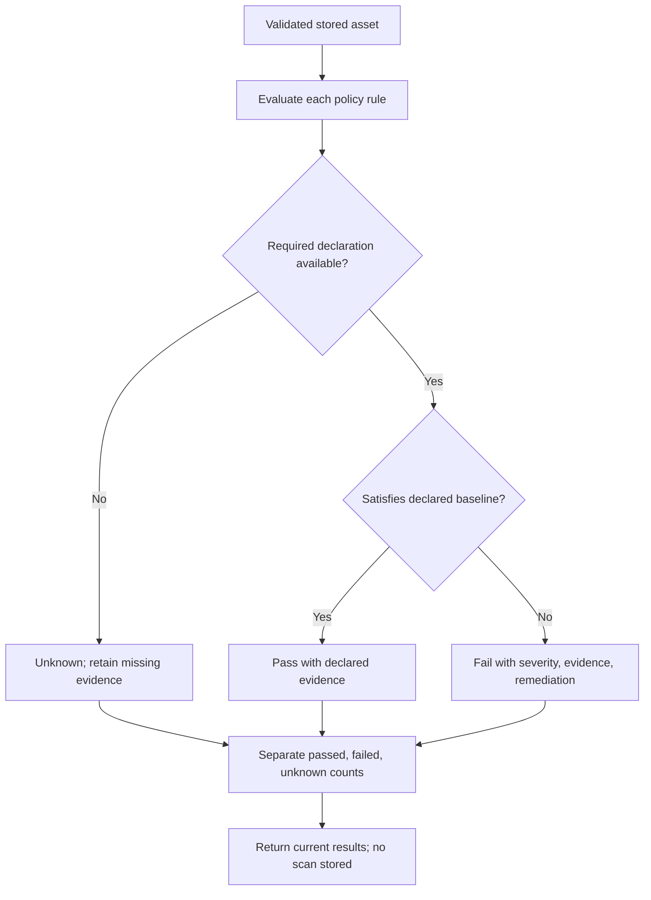
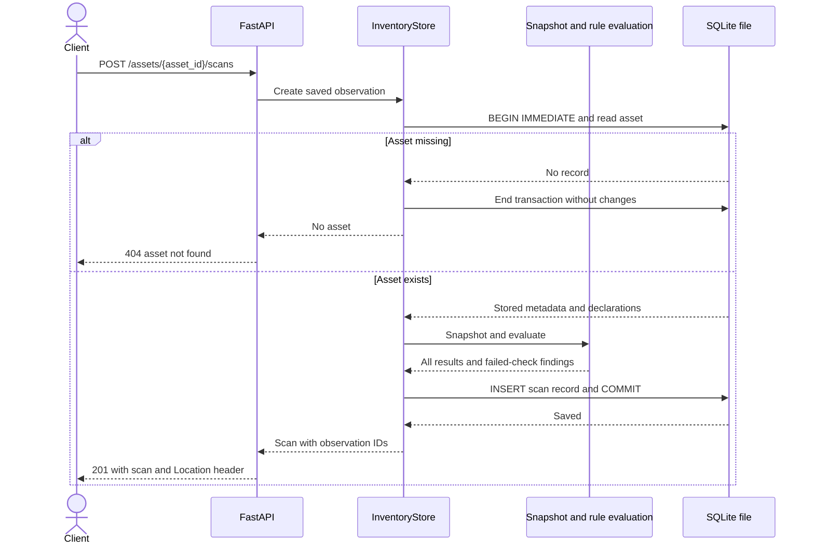

# Inventory and scan architecture

## Components and boundaries

| Component | Responsibility |
| --- | --- |
| `app/main.py` | Application factory, startup, HTTP routes, pagination, and error responses |
| `app/models.py` | Validate asset metadata and represent UUIDs and UTC creation times |
| `app/inventory.py` | Parameterized SQLite queries, scan transactions, and record serialization |
| `app/checks.py` | Pure configuration rules, evidence, and separate pass/fail/unknown counts |
| `app/scans.py` | Asset snapshots, observation IDs, summaries, and failed-check findings |
| SQLite file | Durable inventory and scan records across restarts |

`create_app(database_path)` allows each application instance to use a separate
database. Without an explicit argument, it reads `AI_SPM_DB_PATH` or uses
`data/inventory.sqlite3`. Startup creates the parent directory and missing tables/indexes.
Importing the module alone does not create the database.

Each repository operation opens a short-lived SQLite connection. Writes commit
before the HTTP handler returns success, failed transactions roll back, and the
connection closes after the operation. The `assets` table stores a UUID primary
key, creation timestamp, and a JSON representation of the validated record.
No model endpoint is contacted during inventory operations.

## Create request

Rejected input values are omitted from validation responses. This prevents an
accidentally pasted credential in a rejected URL or unknown field from being
reflected in the error body. Metadata itself is not a secrets store.

## Replace and delete logic

A replacement never inserts a missing record. Optional fields omitted from
`PUT` reset to their schema defaults. Concurrent replacements use the last
successful write; version-based conflict detection is not implemented. Database
operational failures in either flow produce `503` rather than a success response.

## Configuration evaluation

`GET /assets/{asset_id}/checks` reads a stored asset and evaluates four rules in
stable order. Invalid UUIDs return `422`; missing assets return `404`. It neither
changes the asset nor persists results, and never calls a model endpoint.

The nested `security` object stores strict nullable authentication/exposure flags
and nullable permission categories. Missing fields remain `null`; an empty
permissions list is a known declaration of no grants. Old JSON records without
`security` load with unknown controls without rewriting the stored record.
`PUT` still performs full replacement, so omitted security fields reset to unknown.

Transport uses only the declared URL scheme. Exposure is never inferred from a
hostname, and HTTPS never implies authentication. Policy version `1` expects
authentication, internal access, an HTTPS URL when one is declared, and no admin
or wildcard grants. A failure denotes a mismatch with that baseline, not a
confirmed deployed vulnerability. Only failed checks carry severity/remediation;
unknown controls stay visible and are never counted as passes.

## Saving an observation

`POST /assets/{asset_id}/scans` accepts no body or an empty JSON object. A scan is
built from the stored asset rather than client-supplied results. It saves a deep
copy of the asset, the policy version, all check results, their summary, and
findings for failed checks only. Scan timestamps are generated in UTC.

The asset read and scan insertion share one transaction. `BEGIN IMMEDIATE`
reserves the writer before the read, preventing another writer from changing
the asset between reading its declarations and saving the observation.
See [SQLite transaction behavior](https://www.sqlite.org/lang_transaction.html).
Operational storage failures return `503`; failed writes roll back and do not
return a successful scan response.

The `scans` table stores scan UUID, original asset UUID, UTC timestamp, and the
complete serialized observation. An index supports asset-scoped history ordered
by timestamp and UUID. Existing inventory rows are preserved when these tables
and indexes are created. Scans have no cascading dependency on inventory rows,
so deleting an asset leaves its past observations available.

## Reading history

`GET /scans` returns bounded, newest-first summaries, optionally filtered by
asset UUID. `GET /scans/{scan_id}` returns the complete stored observation;
`GET /scans/{scan_id}/findings` returns its failed-check findings. These reads
deserialize stored results and never invoke the current rule evaluator.

Findings retain the original rule ID, severity, evidence, and remediation. Each
has a UUID derived from its scan UUID and rule ID, so IDs stay stable within the
saved observation and differ across scans. Unknown controls remain in the saved
evaluation and cannot become findings or automatic passes. The API provides no
update/delete routes for saved scans and does not track a finding's remediation
state across observations.

## Scope

The inventory API is intended for local development and has no authentication
layer. Configuration checks and saved scans inspect owner declarations only.
Evaluation cases, reports, and a dashboard remain planned.
